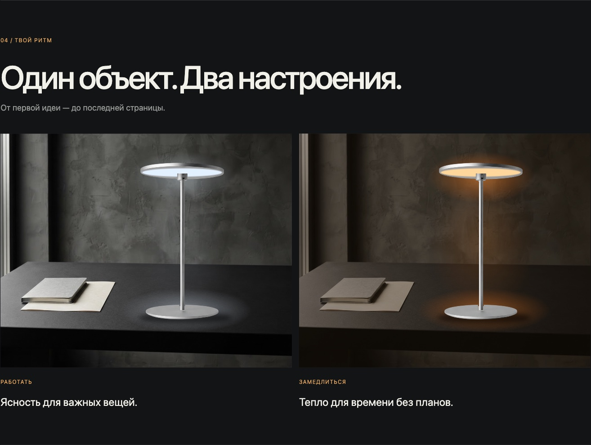

<div align="center">

# СДВИГ

**Свет под твоим углом.** Интерактивный промосайт модульной настольной лампы по макету Figma.

[](https://github.com/mhateb/sdvig-portfolio/actions/workflows/ci.yml)


[Макет в Figma](https://www.figma.com/design/WVmaDV1zAR1h16OpUqaP4I/Untitled?node-id=6-5) · [Локальный запуск](#локальный-запуск) · [Как устроена анимация](#как-устроена-анимация) · [Структура](#структура-проекта)

</div>

Прокрути страницу, чтобы увидеть лампу в разнесённом виде и собрать её обратно. Затем включи свет и посмотри, как один предмет меняет настроение рабочего стола.



*«Работать» и «Замедлиться» — два сценария освещения в одном интерьере.*

## Что посмотреть

1. **Рассмотреть лампу.** Ссылка на первом экране ведёт к конструкции. При прокрутке плафон, шарнир и основание расходятся вокруг неподвижной стойки, задерживаются и снова собираются.
2. **Включить свет.** Переключатель работает мышью и клавиатурой. Янтарный ореол появляется под плафоном и на поверхности стола.
3. **Сравнить сценарии.** На широком экране нейтральный и тёплый свет видны рядом. На телефоне сцены идут друг за другом.

«СДВИГ» — концепт для портфолио. Кнопка «Узнать о старте продаж» открывает пояснение о проекте.

## Как устроена анимация

**Из Figma в SVG.** Маски вырезают плафон, шарнир, стойку и основание из общей текстуры алюминия. Все детали используют систему координат исходного кадра 736 × 920, поэтому при изменении масштаба стыки остаются на своих местах. Эту же модель используем на первом экране, в сборке и в интерьерных сценах. [Геометрия деталей](src/lampParts.ts) · [Компонент лампы](src/Lamp.tsx)

**Из скролла в движение.** ScrollTrigger закрепляет сцену на участке длиной 1,6 высоты окна. `scrub: true` напрямую связывает положение деталей с прокруткой, поэтому при остановке они замирают, а при движении вверх проходят тот же путь в обратном порядке. Первые 28% участка занимают разборка и вывод деталей в разнесённое положение. После паузы они начинают сходиться. Например, плафон возвращается из смещения (+65, −80) в (0, 0) на участке с 64% до 94%. [Шкала GSAP](src/LampAssembly.tsx)

**Включение света.** Состояние переключателя хранится в React. CSS меняет прозрачность ореола и светящегося рассеивателя за 500 мс. При включённом уменьшении движения конструкция показывается статично, а свет меняется сразу. [Переключатель](src/App.tsx)

## Структура проекта

```text
src/
├── App.tsx             страница: первый экран, переключатель света
├── Lamp.tsx            SVG-лампа из масок Figma, с включённым и выключенным светом
├── LampAssembly.tsx    сборка лампы на скролле (GSAP ScrollTrigger)
├── LampScenarios.tsx   сцены «Работать» и «Замедлиться»
├── lampParts.ts        геометрия деталей в системе координат 736 × 920
└── assets/lamp/        SVG-детали, текстура алюминия, фон стола
docs/                   превью для README
```

## Локальный запуск

**Стек** · React, TypeScript, Vite, Tailwind CSS v4, GSAP ScrollTrigger

```sh
git clone https://github.com/mhateb/sdvig-portfolio.git
cd sdvig-portfolio
nvm install
nvm use
npm ci
npm run dev
```

Vite выведет адрес локального сайта в терминал. `npm run lint` проверяет код, а `npm run build` проверяет типы и создаёт статическую сборку в `dist`.
